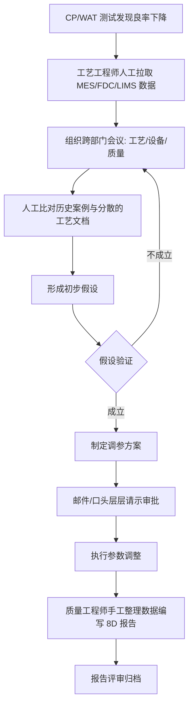
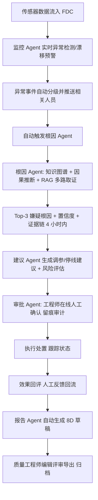

# IndustryAgent 工业智能体平台 — 用户需求说明书（URS）

## 文档控制

| 项目 | 内容 |
|---|---|
| 文档编号 | IA-RM-001 |
| 文档名称 | 用户需求说明书（URS） |
| 版本 | V1.0 |
| 密级 | 内部 |
| 编制 | 李吉 |
| 审核 | |
| 批准 | |
| 日期 | 2026-10-15 |

## 修订记录

| 版本 | 日期 | 修订人 | 修订说明 |
|---|---|---|---|
| V1.0 | 2026-10-15 | 李吉 | 首次发布 |

---

## 1. 业务背景与目标

### 1.1 企业背景（虚拟企业沙盒）

芯联半导体制造有限公司为 12 英寸晶圆制造企业（虚拟），3 条产线，月产能 5 万片晶圆，产品为 MCU 与电源管理芯片。已有系统：MES（制造执行）、ERP（企业资源）、SCADA（数据采集与监控）、FDC（故障检测）、LIMS（实验室信息管理）。系统间数据割裂，缺乏智能分析与人机协同处置能力。

### 1.2 业务目标

| 业务 KPI | 目标值 | 当前值 | 平台贡献路径 |
|---|---|---|---|
| 良率 | 95% | 93% | 根因快速定位→有效调参→缺陷率下降 |
| OEE | 85% | 78% | 漂移早发现、非计划停机减少 |
| 月度停机 | < 2 小时 | 偶发超标 | 停线建议分级与预防性维护 |
| 交付准时率 | 98% | 96% | 异常快速闭环、减少批次滞留 |
| 根因定位时效 | ≤ 4 小时给出 Top-3 嫌疑 | 平均 8 小时 | 根因 Agent 自动化分析 |

### 1.3 核心痛点

| 编号 | 痛点 | 影响 |
|---|---|---|
| P-01 | 良率波动大，根因定位平均 8 小时，依赖跨部门会议反复拉锯 | 处置滞后，损失扩大 |
| P-02 | 设备参数漂移发现滞后，产出异常后才被察觉 | 批量报废风险 |
| P-03 | 工艺文档分散（MES 附件、共享盘、纸质 SOP），检索困难 | 经验无法复用 |
| P-04 | 排产依赖人工经验，异常处置与生产联动不足 | 交付准时率承压 |

### 1.4 平台愿景

构建"监控 → 根因 → 建议 → 审批 → 报告"五类智能体协同的工业智能体平台，在数据不出域、关键建议人工审批、RBAC 全链路审计的硬约束下，实现良率异常的自动化根因定位与人机协同处置，并将处置经验沉淀为知识资产。

## 2. 用户角色与画像

### 2.1 角色清单

| 角色 | 代号 | 职责 | 平台使用频率 |
|---|---|---|---|
| 工艺工程师 | PE | 工艺参数维护、良率异常排查、调参建议审批 | 每日高频 |
| 设备工程师 | EE | 设备健康监测、异常处置、维护执行 | 每日高频 |
| 生产主管 | PP | 排产与交付管理、停线决策 | 每日中频 |
| 质量工程师 | QE | 8D 报告编写与评审、质量体系合规 | 每周中频 |
| 系统管理员 | SA | 用户权限、数据源、系统运维 | 每周低频 |

### 2.2 用户画像

**画像 1 — 工艺工程师 王工（PE）**
- 背景：从业 8 年，熟悉刻蚀/薄膜/光刻工艺，日均处理 2~3 起参数异常；
- 目标：4 小时内锁定根因，减少跨部门拉锯会议；
- 痛点：CP/WAT 良率下降后要人工拉 MES、FDC、LIMS 数据逐项排除；
- 期望：Top-3 嫌疑根因 + 置信度 + 可点击的证据链，能一键采纳/驳回；
- 技术水平：熟练使用 MES/FDC 界面，可接受 Web 工作台。

**画像 2 — 设备工程师 刘工（EE）**
- 背景：负责 3 条产线 60 台关键设备的健康；
- 目标：漂移早发现，非计划停机 <2 小时/月；
- 痛点：告警噪音大，误报一次就跑一趟现场，产生"狼来了"疲劳；
- 期望：告警收敛分级、误报一键标记、漂移趋势提前 24 小时预警。

**画像 3 — 生产主管 陈主管（PP）**
- 背景：管理 3 条产线排产与交付；
- 目标：交付准时率 98%，避免过度停线；
- 痛点：停不停线全靠经验拍板，缺少影响面与成本依据；
- 期望：停线建议附产能影响评估与替代方案（如切换备机/调整批次）。

**画像 4 — 质量工程师 赵工（QE）**
- 背景：负责客诉响应与 8D 报告，每份报告约 4 人时；
- 目标：报告产出提速且符合质量体系要求；
- 痛点：报告数据要从 5 个系统手工搬运，格式易错；
- 期望：8D 草稿自动生成、数据引用可回溯、在线编辑评审导出。

**画像 5 — 系统管理员 孙工（SA）**
- 背景：IT 部门，负责系统账号与运维；
- 目标：权限最小化、操作可审计、系统可观测；
- 痛点：历史系统账号与职责不匹配，审计靠人工翻日志；
- 期望：RBAC 策略可视化管理、审计日志一键导出、Agent 运行状态可监控。

## 3. 业务流程

### 3.1 现有流程（As-Is）—— 良率异常处置

现流程问题：平均 8 小时定位根因；数据靠人工搬运；审批留痕不完整；报告重复劳动；经验未沉淀。

### 3.2 目标流程（To-Be）—— 智能体协同闭环

目标流程改进点：根因定位 8h→≤4h；审批在线化 100% 留痕；8D 报告 4 人时→0.5 人时；反馈回流持续提升 Top-3 准确率。

## 4. 用户需求清单（UR-001 ~ UR-030）

优先级定义：高（Must，v1.0 必须实现）/ 中（Should，v1.0 尽量实现）/ 低（Could，可延后）。

| 编号 | 需求名称 | 需求描述 | 优先级 | 来源角色 | 验收要点 |
|---|---|---|---|---|---|
| UR-001 | 统一身份认证登录 | 所有角色使用企业账号经 Keycloak 统一认证登录，支持单点登录与安全登出 | 高 | 全部角色 | 登录/登出/会话超时符合 NFR；异常登录有提示 |
| UR-002 | 基于角色的权限控制 | 按角色（PE/EE/PP/QE/SA）分配菜单、操作、数据范围权限，默认最小授权 | 高 | SA | 越权访问被拒绝并记录审计 |
| UR-003 | 设备传感器数据实时接入 | 接入 3 条产线关键设备传感器时序参数（温度/压力/流量/功率等），经 MQTT/Kafka 实时入湖 | 高 | EE | 数据端到端延迟 <2s，断点续传 |
| UR-004 | MES/ERP/LIMS 业务数据同步 | 同步工单批次、物料订单、检测结果等业务数据，与设备数据关联 | 高 | PP/PE | 同步任务可监控，失败可重试 |
| UR-005 | FDC 参数异常实时检测与告警 | 对设备参数执行阈值/SPC 多规则检测，异常实时分级告警（信息/警告/严重） | 高 | EE/PE | 注入异常 30 分钟内检出率 ≥90%，告警 <10s 送达 |
| UR-006 | 设备参数漂移识别与预警 | 识别参数缓慢漂移（均值偏移/方差变化），提前预警 | 高 | EE | 漂移注入场景下提前预警，误报率 <10% |
| UR-007 | 异常事件分级与通知推送 | 异常事件按严重级别路由推送给对应角色（站内+邮件），支持升级策略 | 高 | PE | 分级路由正确；未确认事件按策略升级 |
| UR-008 | 良率异常根因 Top-3 分析 | 异常事件自动触发根因分析，输出 Top-3 嫌疑根因及置信度，端到端 <5 分钟 | 高 | PE | Top-3 命中率 >80%（评估集）；延迟达标 |
| UR-009 | 根因证据链可视化 | 每个嫌疑根因展示证据链：关联参数曲线→图谱关系→工艺文档引用，逐层可下钻 | 高 | PE | 证据链接全部可点击溯源 |
| UR-010 | 工艺知识图谱查询 | 构建设备-工艺-参数-缺陷知识图谱（Neo4j），支持自然语言/Cypher 查询 | 中 | PE | 首批 100 实体可查询，查询结果关联异常事件 |
| UR-011 | 工艺文档智能检索（RAG） | 分散工艺文档统一入库，支持语义检索并返回带出处的答案 | 中 | PE | 50 条检索评测集召回率达标，答案附文档出处 |
| UR-012 | 调参建议自动生成 | 基于根因与历史有效案例生成调参建议（含参数项/目标值/依据） | 高 | PE | 建议含风险与依据说明，可追溯历史案例 |
| UR-013 | 停线/维护建议生成 | 异常影响产能或质量风险高时生成停线/维护建议及影响面评估 | 高 | PP/EE | 建议附产能/成本影响估算与替代方案 |
| UR-014 | 建议风险评估与置信度 | 每条建议展示风险评估（影响范围/成本/置信度）供决策参考 | 高 | PE/PP | 评分模型透明可解释 |
| UR-015 | 关键建议人工审批 | 调参/停线类建议必须经人工在线审批（批准/驳回/转审），审批记录完整留痕 | 高 | PE/PP | 100% 留痕；未审批建议不可执行；硬约束 |
| UR-016 | 审批流程审计记录 | 审批人、时间、意见、审批版本全程可追溯，日志不可篡改 | 高 | QE | 审计抽查通过；日志保留 ≥1 年 |
| UR-017 | 8D 报告自动生成 | 依据事件全流程数据自动生成 8D 报告草稿（D1~D8 八步结构完整） | 高 | QE | 生成 <3 分钟；八步结构齐全；数据引用可回溯 |
| UR-018 | 8D 报告编辑与导出 | 报告在线编辑、评审流转、导出 PDF/Word | 中 | QE | 编辑留版本；导出格式符合质量体系模板 |
| UR-019 | 良率综合看板 | 按产线/批次/时间维度展示良率趋势、Top 缺陷、异常事件统计 | 高 | PP | 首屏 <3s；数据下钻联动 |
| UR-020 | OEE 设备效能看板 | 展示产线/设备 OEE 及可用率、性能、质量三分解 | 中 | PP | OEE 计算口径经生产主管确认 |
| UR-021 | 设备健康与告警看板 | 展示设备运行状态、告警列表、漂移趋势排名 | 中 | EE | 告警状态实时刷新；支持误报标记 |
| UR-022 | 异常事件全生命周期管理 | 事件从产生、分析、审批、执行到关闭的状态全程可视、可筛选、可追溯 | 中 | PE/QE | 状态机流转正确；历史可审计 |
| UR-023 | 智能体运行状态监控 | 展示五类 Agent 运行状态、任务成功率、延迟、人工接管率 | 中 | SA | 指标实时采集；异常自动告警 |
| UR-024 | 系统运行监控大屏 | 服务/中间件/队列/数据库健康度一屏可视 | 中 | SA | 覆盖全部核心组件；故障标红 |
| UR-025 | 数据源接入配置管理 | 数据源连接、采集频率、字段映射可视化管理，新增模拟源零代码 | 中 | SA | 配置生效不需改代码；连接测试功能可用 |
| UR-026 | 用户与组织管理 | 用户、部门、岗位、角色管理及账号生命周期管理 | 高 | SA | 与 Keycloak/OPA 联动生效 |
| UR-027 | 历史数据多维查询 | 按时间/产线/设备/批次/参数多维组合查询历史数据并导出 | 中 | PE | 百万行级查询 <8s |
| UR-028 | 人工反馈与标注回流 | 工程师对根因结论/告警进行正确性标注，反馈回流用于评估与优化 | 中 | PE/EE | 标注数据入库；评估报告可引用 |
| UR-029 | 报表订阅与定期导出 | 常用报表订阅推送（周报/月报），支持 Excel/CSV 导出 | 低 | PP | 订阅按期送达；导出数据完整 |
| UR-030 | 全链路审计日志查询 | 系统操作、智能体调用、审批行为全量审计，支持按人/时间/对象检索与导出 | 高 | SA | 审计覆盖 NFR-018 清单；检索响应 <3s |

## 5. 需求优先级与分布统计

| 维度 | 统计 |
|---|---|
| 高优先级（Must） | 15 项（UR-001~009、012~017、026、030） |
| 中优先级（Should） | 13 项（UR-010~011、018、020~025、027~028） |
| 低优先级（Could） | 2 项（UR-019 中部分子集、UR-029） |
| 来源角色分布 | PE 12 项、EE 8 项、PP 7 项、QE 5 项、SA 7 项（多项多角色共有） |

## 6. 硬约束与合规要求

| 编号 | 约束 | 说明 |
|---|---|---|
| CON-01 | 数据不出域 | 全部组件、模型、依赖私有化部署，禁止外部 SaaS/API 调用 |
| CON-02 | 关键建议人工审批 | 调参/停线建议 100% 人工确认后方可执行，不可自动执行 |
| CON-03 | RBAC + 全链路审计 | 权限最小化；操作/审批/智能体调用全程留痕，日志保留 ≥1 年 |
| CON-04 | 可用性 99.9% | 年停机 <8.76 小时，关键服务多副本 |
| CON-05 | 根因时效承诺 | 4 小时内给出 Top-3 嫌疑（业务口径）；分析环节端到端 <5 分钟 |

## 7. 验收与追踪

1. 本清单为《SRS》（IA-RM-002）FR-001~FR-084 的唯一直接来源；每条 UR 映射至 FR、UC、测试用例与迭代，详见《RTM》（IA-RM-004）。
2. 用户需求由对应来源角色（虚拟）在 I1 迭代评审会确认；M1 冻结基线。
3. 验收标准与《项目章程》SC-01~SC-10 一致；评估方法见《非功能需求规格》（IA-RM-005）验证方法列。

## 附录：术语

| 术语 | 定义 |
|---|---|
| CP/WAT | 晶圆测试（CP）与晶圆可接受测试（WAT），良率度量节点 |
| Top-3 | 根因分析输出的前三个嫌疑根因及置信度 |
| 8D | 八步问题解决法报告（D1 组建团队~D8 祝贺团队） |
| 漂移 | 设备参数均值/方差的缓慢偏移，常为劣化前兆 |
| 人工接管率 | 智能体任务由人工接手处理的比例 |
