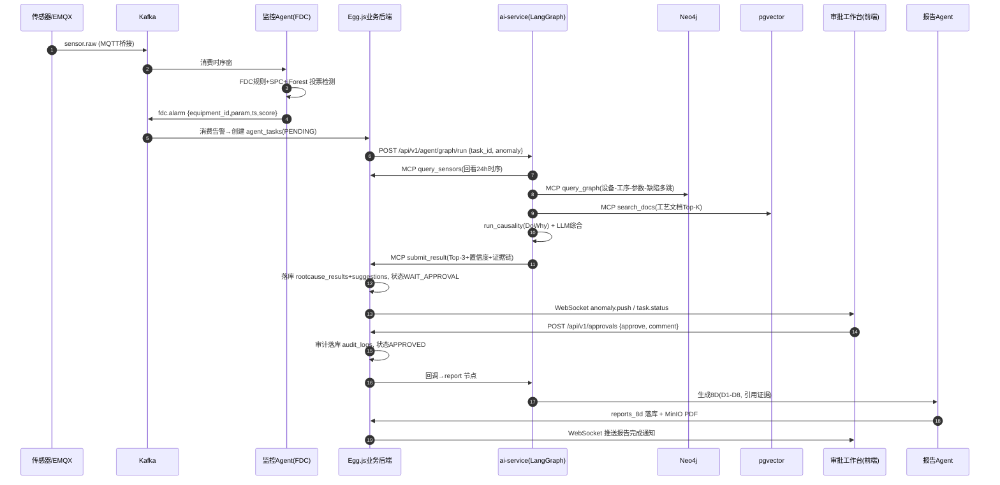

# IndustryAgent 工业智能体平台 —— 后端详细设计说明书

## 文档控制块

| 项目 | 内容 |
|---|---|
| 文档编号 | IA-SD-002 |
| 文档名称 | 后端详细设计说明书（Egg.js 业务后端） |
| 版本 | V1.0 |
| 密级 | 内部 |
| 编制 | 李吉 |
| 审核 | 　 |
| 批准 | 　 |
| 日期 | 2026-10-15 |

## 修订记录

| 版本 | 日期 | 修订人 | 修订说明 |
|---|---|---|---|
| V0.1 | 2026-09-26 | 李吉 | 初稿：工程结构、模块划分 |
| V0.6 | 2026-10-10 | 李吉 | 补充 MCP Server 设计、鉴权/审计中间件流程 |
| V1.0 | 2026-10-15 | 李吉 | 定稿：补全时序图、定时任务、错误码体系 |

---

## 1. 引言

### 1.1 编制目的

本文档定义 IndustryAgent 业务编排层（Egg.js 4.0 业务后端，兼 MCP Server）的工程结构、模块划分、核心类设计、中间件、MCP Server、定时任务与错误码体系，指导后端开发编码实现。

### 1.2 设计范围与边界

- **范围内**：Egg.js 业务后端（服务名 `egg-server`，端口 7001；MCP 端口 7002）；
- **范围外**：Python AI 微服务（见 IA-SD-006）、前端（见 IA-SD-003）、数据库物理设计（见 IA-SD-004）；
- Egg.js 与 ai-service 之间通过 REST + MCP 双通道协作：REST 用于任务触发与状态回写，MCP 用于工具调用。

### 1.3 技术基线

Egg.js 4.0、egg-sequelize（PostgreSQL 方言）、egg-redis、egg-kafka（kafkajs 封装）、egg-socketio（WebSocket）、egg-mcp（MCP Server 插件）、pino 日志、Keycloak OIDC、OPA REST API。

---

## 2. 工程目录结构

```text
egg-server/
├── app/                          # 应用核心
│   ├── router.js                 # 总路由入口（按模块分文件挂载）
│   ├── router/                   # 分模块路由
│   │   ├── auth.js               # 认证路由
│   │   ├── user.js               # 用户管理
│   │   ├── wafer.js              # 晶圆/批次
│   │   ├── defect.js             # 缺陷
│   │   ├── anomaly.js            # 异常事件
│   │   ├── rootcause.js          # 根因分析
│   │   ├── suggestion.js         # 建议
│   │   ├── approval.js           # 审批
│   │   ├── report.js             # 8D 报告
│   │   ├── audit.js              # 系统审计
│   │   └── dashboard.js          # 看板统计
│   ├── controller/               # 控制器（参数校验，不写业务）
│   │   ├── auth.controller.js
│   │   ├── user.controller.js
│   │   ├── wafer.controller.js
│   │   ├── defect.controller.js
│   │   ├── anomaly.controller.js
│   │   ├── rootcause.controller.js
│   │   ├── suggestion.controller.js
│   │   ├── approval.controller.js
│   │   ├── report.controller.js
│   │   ├── audit.controller.js
│   │   └── dashboard.controller.js
│   ├── service/                  # 业务服务（事务边界在这里）
│   │   ├── auth.service.js
│   │   ├── user.service.js
│   │   ├── wafer.service.js
│   │   ├── defect.service.js
│   │   ├── anomaly.service.js
│   │   ├── rootcause.service.js
│   │   ├── suggestion.service.js
│   │   ├── approval.service.js
│   │   ├── report.service.js
│   │   ├── audit.service.js
│   │   ├── dashboard.service.js
│   │   └── mcp/                  # MCP 工具实现（供 mcp 插件注册）
│   │       ├── query_sensors.js
│   │       ├── search_docs.js
│   │       ├── query_graph.js
│   │       └── run_causality.js
│   ├── model/                    # Sequelize 模型（对应 IA-SD-004 表设计）
│   │   ├── user.js
│   │   ├── role.js
│   │   ├── user_role.js
│   │   ├── equipment.js
│   │   ├── recipe.js
│   │   ├── wafer.js
│   │   ├── lot_batch.js
│   │   ├── defect_record.js
│   │   ├── process_doc.js
│   │   ├── agent_task.js
│   │   ├── rootcause_result.js
│   │   ├── suggestion.js
│   │   ├── approval.js
│   │   ├── audit_log.js
│   │   ├── report_8d.js
│   │   └── notification.js
│   ├── middleware/               # 中间件
│   │   ├── auth.js               # JWT 校验（Keycloak JWKS）
│   │   ├── opa.js                # OPA 策略决策
│   │   ├── audit.js              # 审计日志
│   │   ├── errorHandler.js       # 统一错误处理
│   │   ├── rateLimit.js          # 限流（Redis 计数）
│   │   └── requestTrace.js       # trace_id 注入
│   ├── schedule/                 # 定时任务
│   │   ├── yieldDailyReport.js   # 良率日报 06:00
│   │   ├── dataHealthCheck.js    # 数据健康检查 */10 * * * *
│   │   ├── approvalEscalation.js # 审批超时升级 */5 * * * *
│   │   └── kafkaLagMonitor.js    # Kafka 积压监控 */1 * * * *
│   ├── io/                       # WebSocket
│   │   ├── middleware.js         # WS 连接 JWT 校验
│   │   └── controller.js         # anomaly.push / task.status 推送
│   ├── extend/                   # 扩展
│   │   ├── context.js            # ctx.state.user / ctx.ok / ctx.fail
│   │   └── helper.js             # 脱敏、分页、时间工具
│   └── mcp/                      # MCP Server 配置
│       ├── tools.js              # 工具注册表
│       └── schema.js             # JSON Schema 定义
├── config/
│   ├── config.default.js         # 默认配置（DB/Redis/Kafka/Keycloak/OPA/MinIO）
│   ├── config.prod.js
│   ├── config.local.js
│   └── plugin.js                 # 插件启用清单
├── app.js                        # 生命周期：ready 时预热 JWKS/Kafka 连接
├── package.json
└── test/                         # 单测（mocha + egg-mock）
```

---

## 3. 模块划分与职责表

| 模块 | 路由前缀 | 核心职责 | 依赖模型 | 依赖中间件 |
|---|---|---|---|---|
| auth/user | /api/v1/auth, /api/v1/users | Keycloak 登录交换、用户 CRUD、角色分配 | users, roles, user_roles | auth, opa, audit |
| wafer | /api/v1/wafers, /api/v1/lots | 晶圆/批次档案查询、批次-设备-Recipe 关联 | wafers, lot_batches, equipments, recipes | auth, opa |
| defect | /api/v1/defects | 缺陷记录查询、缺陷图 MinIO 预签名 URL、缺陷统计 | defect_records | auth, opa |
| sensor | /api/v1/sensors | 传感器时序查询（转发 TimescaleDB 查询）、测点清单 | sensor_readings(时序) | auth, opa, rateLimit |
| anomaly（异常事件） | /api/v1/anomalies | FDC 告警消费落库、异常事件列表/详情、状态流转 | agent_tasks | auth, opa, audit |
| agent-task | /api/v1/agent-tasks | 智能体任务创建/状态查询/重试/人工接管 | agent_tasks, rootcause_results | auth, opa, audit |
| approval | /api/v1/approvals | 建议审批工作台：待审列表、批准/驳回、升级记录 | approvals, suggestions | auth, opa, audit |
| report | /api/v1/reports | 8D 报告列表/详情、PDF 导出（MinIO）、归档 | reports_8d | auth, opa, audit |
| audit | /api/v1/audits | 审计日志检索（仅管理员）、审计导出 | audit_logs | auth, opa |
| dashboard | /api/v1/dashboard | 良率/OEE/异常趋势聚合（Redis 缓存） | 多表聚合 | auth, opa, rateLimit |

---

## 4. 核心类设计

### 4.1 BaseController / Service 基类约定

```javascript
// app/extend/context.js —— 统一响应
ctx.ok(data)            // → { code: 0, message: 'success', data }
ctx.fail(code, message) // → { code: 'IA-10401', message, data: null }
```

### 4.2 AgentTaskService（智能体任务服务，核心类）

```javascript
// app/service/rootcause.service.js（节选）
class AgentTaskService extends Service {
  /**
   * 异常事件触发根因分析任务（幂等：同 anomaly_id 未终态不重复创建）
   * 状态机: PENDING → RUNNING → WAIT_APPROVAL → APPROVED/REJECTED → REPORTED
   */
  async createTask({ anomalyId, priority }) { /* ... */ }

  /** 调用 ai-service 触发 LangGraph，携带 trace_id 与回调地址 */
  async dispatch(aiServiceUrl, task) { /* ... */ }

  /** ai-service 回调：写 rootcause_results(Top-3+证据链)，状态→WAIT_APPROVAL */
  async onRootcauseCompleted(taskId, payload) { /* ... */ }

  /** 人工接管：记录接管人，终态 TAKEOVER，计入人工接管率指标 */
  async takeOver(taskId, userId, reason) { /* ... */ }
}
```

### 4.3 ApprovalService（审批服务）

```javascript
class ApprovalService extends Service {
  /** 批准：事务内更新 approvals + suggestions.status=APPROVED + 写审计 */
  async approve({ suggestionId, approverId, comment }) { /* ... */ }
  /** 驳回：驳回理由回流评估Agent（Kafka topic: agent.feedback） */
  async reject({ suggestionId, approverId, reason }) { /* ... */ }
}
```

### 4.4 状态机

```text
agent_tasks.status 枚举流转：
PENDING ──dispatch──► RUNNING ──根因+建议完成──► WAIT_APPROVAL
   │                    │                          │
   │ 派发失败(重试3次)    │ 执行异常                  ├─批准──► APPROVED ──8D生成──► REPORTED
   ▼                    ▼                          ├─驳回──► REJECTED
FAILED                FAILED/RETRYING              └─超时2h──► ESCALATED(转人工工单)
任意非终态 ──人工接管──► TAKEOVER
```

---

## 5. 鉴权中间件流程

```javascript
// app/middleware/auth.js
// 1. 提取 Authorization: Bearer <access_token>
// 2. 本地校验：JWKS 公钥验签、exp/nbf、iss=https://keycloak:8080/realms/ia、aud=ia-api
// 3. Redis 黑名单检查（登出/吊销的 jti）
// 4. 解析 claims → ctx.state.user = { id: sub, username, roles: [..], jti }
// 5. 失败 → 401 { code: 'IA-10401' }
```

```javascript
// app/middleware/opa.js —— 每请求策略决策
// POST http://opa:8181/v1/data/ia/authz/allow
// input = { user, roles, method, path, resource_id }
// 决策结果缓存 30s（key: roles+method+path 模板）以降低 OPA 压力
// deny → 403 { code: 'IA-10403' }，同时写审计（拒绝留痕）
```

策略示例（Rego，五角色）：

```rego
package ia.authz
default allow = false
# 工艺工程师：审批调参建议、查看根因
allow if {
  input.roles[_] == "process_engineer"
  input.method == "POST"
  startswith(input.path, "/api/v1/approvals")
}
# 系统管理员：审计检索、用户管理
allow if {
  input.roles[_] == "admin"
  startswith(input.path, "/api/v1/audits")
}
```

---

## 6. 审计中间件

```javascript
// app/middleware/audit.js
// 拦截规则：
//   - 全部 POST/PUT/PATCH/DELETE
//   - 敏感 GET：/rootcause-results/*、/reports/*、/audits/*
// 记录字段（写入 audit_logs，异步批量，不阻塞主链路）：
//   { user_id, username, action(方法), resource(路径模板), resource_id,
//     request_digest(脱敏后JSON摘要≤2KB), status_code, duration_ms,
//     ip, trace_id, created_at }
// 采集响应后通过 internal Kafka topic(ia.audit) 批量落库，削峰保护 PG。
```

---

## 7. MCP Server 设计

Egg.js 4.0 作为 MCP Server（端口 7002，stdio/SSE 双传输），将业务与数据能力统一封装为 MCP 工具，供 Python 智能体（LangGraph tool 调用）使用。

### 7.1 工具注册方式

```javascript
// app/mcp/tools.js
module.exports = app => ({
  query_sensors: {
    description: '查询设备传感器时序数据（TimescaleDB）',
    inputSchema: { /* 见 IA-SD-005 第9章 */ },
    handler: async input => app.sensorsMcp.query(input), // 复用 service 层
    permission: 'sensor:read',
  },
  search_docs:    { /* RAG 检索 pgvector */ },
  query_graph:    { /* Neo4j 图谱查询（Cypher 模板，参数化） */ },
  run_causality:  { /* 代理 ai-service DoWhy 因果分析 */ },
  query_defects:  { /* 缺陷记录检索 */ },
  submit_result:  { /* 智能体回写根因/建议结果 */ },
});
```

### 7.2 设计要点

1. **工具即业务复用**：handler 直接调用 app 内 service，保证 REST API 与 MCP 工具共享同一套权限与审计逻辑；
2. **权限校验**：MCP 会话建立时携带服务令牌（ai-service 专用身份），按工具 `permission` 字段二次鉴权；
3. **Schema 即契约**：inputSchema/outputSchema 使用 JSON Schema，前后端与智能体三方共享（npm 包 `@ia/contracts` 发布）；
4. **审计**：每次工具调用记录 `tool_name/input_digest/duration/trace_id` 至 audit_logs。

---

## 8. 关键时序图（全链路）



---

## 9. 定时任务（schedule）

| 任务 | cron | 职责 | 异常处理 |
|---|---|---|---|
| yieldDailyReport | `0 0 6 * * *` | 聚合昨日良率/OEE/异常数/Top根因分布，生成日报写 notifications + 通知生产主管 | 失败重试 2 次，仍失败发 Grafana 告警 |
| dataHealthCheck | `0 */10 * * * *` | 检查各源系统数据新鲜度（最后写入时间）、缺失率、Kafka lag，结果写 Redis + 异常发 notifications | 单源失败不影响其他源检查 |
| approvalEscalation | `0 */5 * * * *` | 扫描 WAIT_APPROVAL 超过 30min 的审批→升级通知生产主管；超 2h→状态 ESCALATED | 幂等：升级记录去重 |
| kafkaLagMonitor | `0 */1 * * * *` | 消费组 lag>100000 触发告警与自动扩容标记 | — |

```javascript
// app/schedule/yieldDailyReport.js
module.exports = {
  schedule: { cron: '0 0 6 * * *', type: 'worker' },
  async task(ctx) {
    const report = await ctx.service.dashboard.buildDailyReport(yesterday());
    await ctx.model.Notification.create({ type: 'DAILY_REPORT', payload: report, targetRole: 'production_manager' });
  },
};
```

---

## 10. 异常与错误码体系

### 10.1 错误响应统一结构

```json
{ "code": "IA-10401", "message": "令牌无效或已过期", "data": null }
```

### 10.2 错误码分类段（详见 IA-SD-005 第2章）

| 段 | 分类 | 示例 |
|---|---|---|
| IA-10xxx | 通用/认证授权 | IA-10401 未认证、IA-10403 无权限、IA-10429 限流 |
| IA-11xxx | 资源类 | IA-11001 资源不存在、IA-11002 参数校验失败 |
| IA-12xxx | 业务流程 | IA-12001 任务状态非法流转、IA-12002 重复审批 |
| IA-13xxx | 智能体协作 | IA-13001 ai-service 不可用、IA-13002 MCP 工具超时、IA-13003 证据链不完整 |
| IA-15xxx | 系统内部 | IA-15001 数据库错误、IA-15002 Kafka 异常、IA-15003 MinIO 异常 |

### 10.3 全局异常处理

```javascript
// app/middleware/errorHandler.js
// 1. BusinessException(带code) → 直接返回 4xx/业务码
// 2. SequelizeValidationError → IA-11002 + 字段明细
// 3. 未知异常 → 500 + IA-15000，原始堆栈仅写日志（pino error + trace_id），不外泄
```

---

## 11. 配置管理要点（config.default.js 节选）

```javascript
exports.sequelize = { dialect: 'postgres', host: 'postgres', port: 5432,
  database: 'ia_business', username: 'ia_app', password: process.env.PG_PASSWORD };
exports.redis = { client: { host: 'redis', port: 6379 } };
exports.kafka = { brokers: ['kafka:9092'], clientId: 'egg-server' };
exports.keycloak = { issuer: 'https://keycloak:8080/realms/ia', audience: 'ia-api' };
exports.opa = { url: 'http://opa:8181/v1/data/ia/authz/allow' };
exports.aiService = { baseUrl: 'http://ai-service:8000' };
exports.mcp = { port: 7002, transport: ['stdio', 'sse'] };
```

---

## 12. 与其他文档的关系

| 主题 | 参见 |
|---|---|
| 表结构字段级设计 | IA-SD-004 |
| REST/WS/MCP 接口字段级设计 | IA-SD-005 |
| 智能体编排与提示词 | IA-SD-006 |
| Egg.js 选型决策 | ADR-001 |

（全文完）
