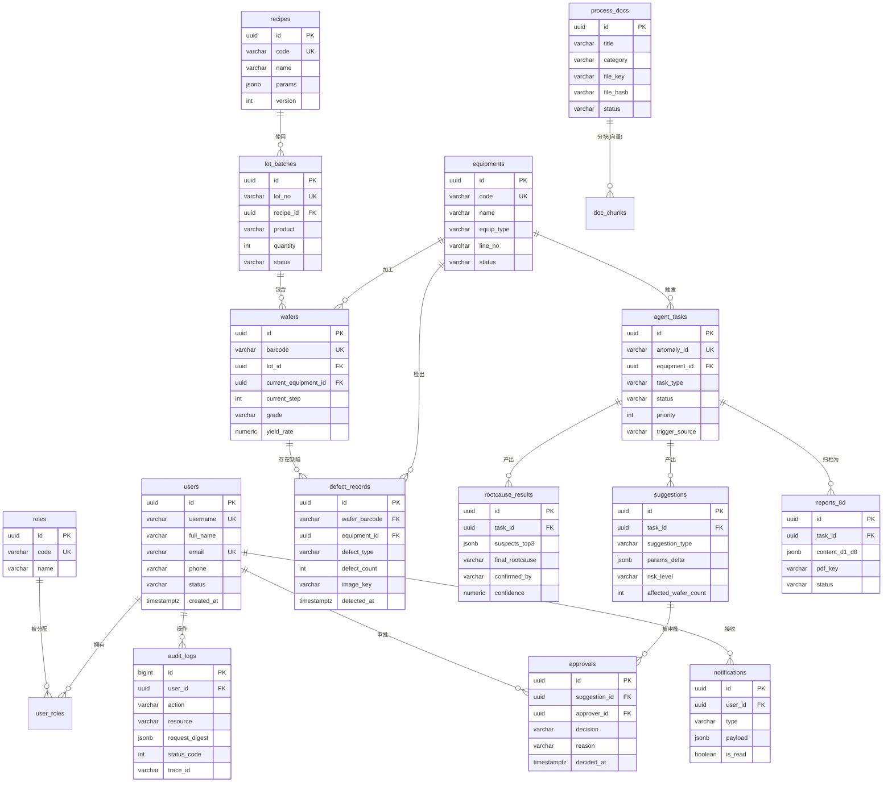

# IndustryAgent 工业智能体平台 —— 数据库设计说明书

## 文档控制块

| 项目 | 内容 |
|---|---|
| 文档编号 | IA-SD-004 |
| 文档名称 | 数据库设计说明书 |
| 版本 | V1.0 |
| 密级 | 内部 |
| 编制 | 李吉 |
| 审核 | 　 |
| 批准 | 　 |
| 日期 | 2026-10-15 |

## 修订记录

| 版本 | 日期 | 修订人 | 修订说明 |
|---|---|---|---|
| V0.1 | 2026-09-30 | 李吉 | 初稿：业务表 + ER 草图 |
| V0.6 | 2026-10-12 | 李吉 | 补充 TimescaleDB 超表、pgvector、Neo4j 图模型 |
| V1.0 | 2026-10-15 | 李吉 | 定稿：索引策略、容量规划、压缩保留策略 |

---

## 1. 引言

### 1.1 存储拓扑总览

| 存储 | 承载数据 | 库/Schema |
|---|---|---|
| PostgreSQL 16 + TimescaleDB + pgvector | 业务表 + 时序超表 + 向量表 | 库 `ia_business`，schema：`biz`（业务）、`ts`（时序）、`vec`（向量） |
| Neo4j 5 | 知识图谱（设备/工序/参数/缺陷关联） | 库 `neo4j` |
| MinIO | 缺陷图、工艺文档、8D 报告 PDF | bucket：`defect-images`、`process-docs`、`reports-8d` |
| Redis | 缓存/会话/黑名单/限流 | db0 缓存、db1 会话 |

选型理由见 ADR-002。

### 1.2 设计规范

1. **命名**：表/字段一律 `snake_case`；表名复数（`users`）；索引 `idx_<表>_<字段>`；唯一索引 `uk_<表>_<字段>`；外键 `fk_<表>_<引用表>`；
2. **主键**：业务表统一 `id UUID DEFAULT gen_random_uuid()`（避免序列暴露业务量）；时序表使用 `(equipment_id, ts)` 复合主键；
3. **通用字段**：业务表统一携带 `created_at TIMESTAMPTZ DEFAULT now()`、`updated_at TIMESTAMPTZ`；软删表增加 `deleted_at TIMESTAMPTZ`；
4. **枚举**：使用 `VARCHAR(32) + CHECK 约束`（便于扩展），前端字典与后端常量同步；
5. **金额/数量**：`NUMERIC`；时间一律 `TIMESTAMPTZ`（东八区展示由应用层处理）；
6. **禁止**：外键级联删除（应用层保证）、`SELECT *`、跨 schema 隐式join超3表（用视图收敛）；
7. **变更管理**：DDL 走 Flyway 版本化迁移脚本（`V2026.10.15.001__init.sql` 起序）。

---

## 2. ER 总图（业务库）



---

## 3. 业务表详细设计（schema: biz）

### 3.1 users（用户）

| 字段 | 类型 | 约束 | 说明 |
|---|---|---|---|
| id | UUID | PK, DEFAULT gen_random_uuid() | 用户ID |
| username | VARCHAR(64) | NOT NULL, UNIQUE | 登录名（与 Keycloak username 一致） |
| full_name | VARCHAR(64) | NOT NULL | 姓名 |
| email | VARCHAR(128) | UNIQUE | 邮箱（脱敏展示） |
| phone | VARCHAR(20) | — | 手机号（脱敏展示） |
| keycloak_id | VARCHAR(64) | UNIQUE | Keycloak sub，OIDC 关联 |
| department | VARCHAR(64) | — | 部门（工艺部/设备部/生产部/质量部/IT部） |
| status | VARCHAR(16) | CHECK IN ('ACTIVE','DISABLED') | 状态 |
| last_login_at | TIMESTAMPTZ | — | 最后登录 |
| created_at / updated_at | TIMESTAMPTZ | DEFAULT now() | — |

索引：`uk_users_username`、`uk_users_keycloak_id`。

### 3.2 roles（角色）与 user_roles（用户角色）

roles：

| 字段 | 类型 | 约束 | 说明 |
|---|---|---|---|
| id | UUID | PK | — |
| code | VARCHAR(32) | NOT NULL, UNIQUE | process_engineer / equipment_engineer / production_manager / quality_engineer / admin |
| name | VARCHAR(64) | NOT NULL | 显示名（工艺工程师等） |
| description | VARCHAR(255) | — | — |

user_roles：

| 字段 | 类型 | 约束 | 说明 |
|---|---|---|---|
| user_id | UUID | FK→users.id, ON DELETE CASCADE | — |
| role_id | UUID | FK→roles.id | — |
| granted_by | UUID | FK→users.id | 授权人（审计） |
| created_at | TIMESTAMPTZ | DEFAULT now() | — |

主键：`(user_id, role_id)`。

### 3.3 equipments（设备）

| 字段 | 类型 | 约束 | 说明 |
|---|---|---|---|
| id | UUID | PK | — |
| code | VARCHAR(32) | NOT NULL, UNIQUE | 设备编码，如 ETCH-03、CVD-11 |
| name | VARCHAR(128) | NOT NULL | 设备名称 |
| equip_type | VARCHAR(32) | NOT NULL, CHECK IN ('ETCH','CVD','LITH','DIFF','CMP','IMPL','CLEAN','METRO') | 设备类型 |
| line_no | VARCHAR(8) | NOT NULL, CHECK IN ('L1','L2','L3') | 所属产线 |
| vendor | VARCHAR(64) | — | 厂商 |
| install_date | DATE | — | 投产日期 |
| status | VARCHAR(16) | CHECK IN ('RUNNING','IDLE','PM','DOWN') | 运行状态 |
| created_at / updated_at | TIMESTAMPTZ | — | — |

索引：`idx_equipments_line_type (line_no, equip_type)`。

### 3.4 recipes（工艺配方）

| 字段 | 类型 | 约束 | 说明 |
|---|---|---|---|
| id | UUID | PK | — |
| code | VARCHAR(64) | NOT NULL | 配方编码，如 MC-ETCH-2041 |
| name | VARCHAR(128) | NOT NULL | 配方名 |
| product | VARCHAR(32) | CHECK IN ('MCU','PMIC') | 适用产品 |
| version | INTEGER | NOT NULL, DEFAULT 1 | 版本 |
| params | JSONB | NOT NULL | 参数基准集 `{"RF_POWER":1250,"PRESSURE":3.2,...}` |
| spec_limits | JSONB | — | 参数规格上下限 `{"RF_POWER":{"lsl":1200,"usl":1300}}` |
| status | VARCHAR(16) | CHECK IN ('DRAFT','RELEASED','OBSOLETE') | — |
| created_at / updated_at | TIMESTAMPTZ | — | — |

唯一约束：`uk_recipes_code_ver (code, version)`。

### 3.5 lot_batches（生产批次）

| 字段 | 类型 | 约束 | 说明 |
|---|---|---|---|
| id | UUID | PK | — |
| lot_no | VARCHAR(32) | NOT NULL, UNIQUE | 批次号，如 LOT-20261014-007 |
| recipe_id | UUID | FK→recipes.id | 工艺配方 |
| product | VARCHAR(32) | NOT NULL | MCU / PMIC |
| quantity | INTEGER | NOT NULL | 晶圆数（25 片/批典型） |
| line_no | VARCHAR(8) | NOT NULL | 产线 |
| current_step | INTEGER | — | 当前工序步序 |
| status | VARCHAR(16) | CHECK IN ('WIP','DONE','HOLD','SCRAP') | — |
| plan_start_at / plan_end_at | TIMESTAMPTZ | — | 计划（排产） |
| created_at / updated_at | TIMESTAMPTZ | — | — |

### 3.6 wafers（晶圆）

| 字段 | 类型 | 约束 | 说明 |
|---|---|---|---|
| id | UUID | PK | — |
| barcode | VARCHAR(32) | NOT NULL, UNIQUE | 晶圆条码 W-20261014-000123 |
| lot_id | UUID | FK→lot_batches.id | 所属批次 |
| current_equipment_id | UUID | FK→equipments.id, NULL | 当前所在设备（WIP 时） |
| current_step | INTEGER | — | 当前工序 |
| grade | VARCHAR(8) | CHECK IN ('A','B','C','D') | 成品等级 |
| yield_rate | NUMERIC(5,2) | — | 良率%（CP 后回填） |
| started_at / completed_at | TIMESTAMPTZ | — | 起止 |
| created_at | updated_at | TIMESTAMPTZ | — |

索引：`idx_wafers_lot (lot_id)`、`idx_wafers_yield (yield_rate)`。

### 3.7 defect_records（缺陷记录）

| 字段 | 类型 | 约束 | 说明 |
|---|---|---|---|
| id | UUID | PK | — |
| wafer_barcode | VARCHAR(32) | NOT NULL, FK→wafers.barcode | 晶圆 |
| equipment_id | UUID | FK→equipments.id | 检出/疑似引入设备 |
| process_step | VARCHAR(64) | — | 工序（与图谱 ProcessStep 对齐） |
| defect_type | VARCHAR(32) | NOT NULL | 缺陷类型：SCRATCH / PARTICLE / PATTERN / CORROSION / OTHER |
| defect_count | INTEGER | NOT NULL, DEFAULT 1 | 数量 |
| x_pos / y_pos | NUMERIC(8,2) | — | 缺陷坐标（mm，缺陷图叠加） |
| image_key | VARCHAR(255) | — | MinIO 对象键（defect-images/2026/10/xxx.png） |
| severity | VARCHAR(8) | CHECK IN ('LOW','MID','HIGH') | 严重度 |
| detected_at | TIMESTAMPTZ | NOT NULL | 检出时间 |
| created_at | TIMESTAMPTZ | DEFAULT now() | — |

索引：`idx_defects_wafer (wafer_barcode)`、`idx_defects_type_time (defect_type, detected_at DESC)`。

### 3.8 process_docs（工艺文档元数据）

| 字段 | 类型 | 约束 | 说明 |
|---|---|---|---|
| id | UUID | PK | — |
| title | VARCHAR(255) | NOT NULL | 文档标题 |
| category | VARCHAR(32) | NOT NULL | 类别：SOP / FMEA / SPEC / CAPA_REPORT / 8D_ARCHIVE |
| doc_code | VARCHAR(64) | UNIQUE | 文档编号 |
| file_key | VARCHAR(255) | NOT NULL | MinIO 对象键（process-docs/…） |
| file_hash | VARCHAR(64) | NOT NULL | SHA-256（去重与完整性） |
| chunk_count | INTEGER | DEFAULT 0 | 分块数（向量化进度） |
| embed_status | VARCHAR(16) | CHECK IN ('PENDING','EMBEDDING','DONE','FAILED') | 向量化状态 |
| equipment_codes | TEXT[] | — | 关联设备（图谱挂接） |
| version | VARCHAR(16) | — | 文档版本 |
| uploader_id | UUID | FK→users.id | 上传人 |
| status | VARCHAR(16) | CHECK IN ('ACTIVE','ARCHIVED') | — |
| created_at / updated_at | TIMESTAMPTZ | — | — |

### 3.9 agent_tasks（智能体任务）

| 字段 | 类型 | 约束 | 说明 |
|---|---|---|---|
| id | UUID | PK | — |
| anomaly_id | VARCHAR(64) | NOT NULL, UNIQUE | 异常事件号 AN-YYYYMMDD-NNNN |
| equipment_id | UUID | FK→equipments.id | 关联设备 |
| param_name | VARCHAR(64) | — | 触发参数（RF_POWER 等） |
| task_type | VARCHAR(32) | NOT NULL, DEFAULT 'ROOTCAUSE' | 任务类型 |
| status | VARCHAR(24) | CHECK IN ('PENDING','RUNNING','WAIT_APPROVAL','APPROVED','REJECTED','REPORTED','ESCALATED','TAKEOVER','FAILED') | 状态机见 IA-SD-002 |
| priority | SMALLINT | DEFAULT 2 | 1 高 2 中 3 低 |
| trigger_source | VARCHAR(16) | CHECK IN ('FDC_ALARM','MANUAL','SCHEDULE') | 触发源 |
| started_at / finished_at | TIMESTAMPTZ | — | 起止（耗时统计） |
| retry_count | SMALLINT | DEFAULT 0 | 重试次数（上限3） |
| takeover_by | UUID | FK→users.id, NULL | 人工接管人 |
| graph_run_id | VARCHAR(64) | — | LangGraph run id（追溯） |
| trace_id | VARCHAR(64) | — | 全链路追踪 ID |
| created_at / updated_at | TIMESTAMPTZ | — | — |

索引：`idx_tasks_status_created (status, created_at DESC)`、`idx_tasks_equipment (equipment_id)`。

### 3.10 rootcause_results（根因分析结果）

| 字段 | 类型 | 约束 | 说明 |
|---|---|---|---|
| id | UUID | PK | — |
| task_id | UUID | NOT NULL, FK→agent_tasks.id, UNIQUE | 任务（1:1） |
| suspects_top3 | JSONB | NOT NULL | Top-3 嫌疑数组，结构见下 |
| final_rootcause | VARCHAR(128) | — | 人工/审批确认的最终根因 |
| confirmed_by | UUID | FK→users.id, NULL | 确认人 |
| confidence | NUMERIC(5,2) | — | 综合置信度% |
| model_meta | JSONB | — | 模型版本、DoWhy 配置、Token 消耗 |
| created_at | TIMESTAMPTZ | DEFAULT now() | — |

`suspects_top3` JSON 结构（证据链核心契约）：

```json
[
  {
    "rank": 1,
    "equipmentCode": "ETCH-03",
    "processStep": "ETCH_MAIN",
    "paramName": "RF_POWER",
    "confidence": 0.87,
    "evidences": [
      { "type": "GRAPH", "desc": "ETCH-03-RF_POWER 与缺陷 PATTERN 三跳关联",
        "detail": { "path": ["Equipment(ETCH-03)","HAS_PARAM(RF_POWER)","CORRELATES(PATTERN)"], "weight": 0.82 } },
      { "type": "CAUSAL", "desc": "DoWhy 估计效应 0.41 (95%CI [0.33,0.49])",
        "detail": { "estimand": "att", "effect": 0.41, "pvalue": 0.003 } },
      { "type": "RAG", "desc": "《ETCH-03 历史CAPA-2025-118》RF_POWER 漂移案例",
        "detail": { "docId": "uuid-…", "chunkId": 42, "score": 0.89, "quote": "…" } },
      { "type": "SENSOR", "desc": "近24h RF_POWER 均值 +3.2%（超SPC UCL）",
        "detail": { "window": "24h", "meanShiftPct": 3.2, "uclBreach": true } }
    ]
  }
]
```

### 3.11 suggestions（建议）

| 字段 | 类型 | 约束 | 说明 |
|---|---|---|---|
| id | UUID | PK | — |
| task_id | UUID | NOT NULL, FK→agent_tasks.id | 任务 |
| suspect_rank | SMALLINT | — | 针对第几嫌疑（1-3） |
| suggestion_type | VARCHAR(24) | CHECK IN ('PARAM_ADJUST','PM_PLAN','STOP_LINE','RECHECK_WAFER') | 建议类型 |
| content | TEXT | NOT NULL | 建议正文（结构化模板生成） |
| params_delta | JSONB | — | 调参明细 `{"RF_POWER":{"from":1290,"to":1250,"unit":"W"}}` |
| risk_level | VARCHAR(8) | CHECK IN ('LOW','MID','HIGH') | 风险等级 |
| risk_assessment | TEXT | — | 风险评估说明（影响良率/交付/安全） |
| affected_wafer_count | INTEGER | — | 影响晶圆数估算 |
| estimated_benefit | VARCHAR(255) | — | 预期收益（良率恢复预估） |
| status | VARCHAR(16) | CHECK IN ('PENDING','APPROVED','REJECTED','EXPIRED','EXECUTED') | — |
| created_at / updated_at | TIMESTAMPTZ | — | — |

### 3.12 approvals（审批记录）

| 字段 | 类型 | 约束 | 说明 |
|---|---|---|---|
| id | UUID | PK | — |
| suggestion_id | UUID | NOT NULL, FK→suggestions.id | 被审建议 |
| approver_id | UUID | NOT NULL, FK→users.id | 审批人 |
| approver_role | VARCHAR(32) | NOT NULL | 审批时角色 |
| decision | VARCHAR(16) | CHECK IN ('APPROVED','REJECTED','ESCALATED') | 决定 |
| reason | TEXT | NOT NULL | 审批理由（驳回必填≥10字） |
| decided_at | TIMESTAMPTZ | NOT NULL | 审批时间 |
| sla_minutes | INTEGER | — | 从提审到决策耗时（指标统计） |
| escalated_to | UUID | FK→users.id, NULL | 升级目标人 |
| created_at | TIMESTAMPTZ | DEFAULT now() | — |

索引：`idx_approvals_suggestion (suggestion_id)`、`idx_approvals_decided (decided_at DESC)`。

### 3.13 audit_logs（审计日志，仅追加，按月分区）

| 字段 | 类型 | 约束 | 说明 |
|---|---|---|---|
| id | BIGINT | PK（分区键外） | — |
| user_id | UUID | FK→users.id | 操作人 |
| username | VARCHAR(64) | NOT NULL | 冗余（用户删除后仍可读） |
| action | VARCHAR(16) | NOT NULL | GET/POST/PUT/DELETE/TOOL_CALL |
| resource | VARCHAR(128) | NOT NULL | 路径模板 /api/v1/approvals/:id |
| resource_id | VARCHAR(64) | — | 资源ID |
| request_digest | JSONB | — | 脱敏后请求摘要（≤2KB） |
| status_code | INTEGER | — | 响应码 |
| duration_ms | INTEGER | — | 耗时 |
| ip | INET | — | 来源 |
| trace_id | VARCHAR(64) | — | 追踪ID |
| created_at | TIMESTAMPTZ | NOT NULL | 分区键，PARTITION BY RANGE |

### 3.14 reports_8d（8D 报告）

| 字段 | 类型 | 约束 | 说明 |
|---|---|---|---|
| id | UUID | PK | — |
| report_no | VARCHAR(32) | NOT NULL, UNIQUE | 8D-YYYYMMDD-NNN |
| task_id | UUID | NOT NULL, FK→agent_tasks.id | 关联任务 |
| title | VARCHAR(255) | NOT NULL | 报告标题 |
| content_d1_d8 | JSONB | NOT NULL | D1-D8 结构化内容（见 IA-SD-006 报告Agent） |
| pdf_key | VARCHAR(255) | — | MinIO 归档键（reports-8d/…） |
| status | VARCHAR(16) | CHECK IN ('DRAFT','REVIEW','RELEASED') | — |
| author_id | UUID | FK→users.id | 质量工程师（签发） |
| created_at / updated_at | TIMESTAMPTZ | — | — |

### 3.15 notifications（通知）

| 字段 | 类型 | 约束 | 说明 |
|---|---|---|---|
| id | UUID | PK | — |
| user_id | UUID | FK→users.id, NULL | 定向；NULL 按 target_role 广播 |
| target_role | VARCHAR(32) | — | 角色广播 |
| type | VARCHAR(32) | NOT NULL | ANOMALY / APPROVAL_REQUIRED / APPROVAL_ESCALATED / DAILY_REPORT / SYSTEM_ALERT |
| title | VARCHAR(255) | NOT NULL | — |
| payload | JSONB | — | 事件负载 |
| is_read | BOOLEAN | DEFAULT false | — |
| event_id | VARCHAR(64) | — | WS eventId（断线补偿游标） |
| created_at | TIMESTAMPTZ | DEFAULT now() | — |

索引：`idx_notif_unread (user_id, is_read, created_at DESC)`。

---

## 4. TimescaleDB 超表设计（schema: ts）

### 4.1 sensor_readings 超表

```sql
CREATE TABLE ts.sensor_readings (
    equipment_id  UUID        NOT NULL,
    ts            TIMESTAMPTZ NOT NULL,
    param_name    VARCHAR(64) NOT NULL,          -- 测点: RF_POWER/PRESSURE/TEMP_1/FLOW_2...
    value         DOUBLE PRECISION NOT NULL,     -- 读数
    quality       VARCHAR(8)  DEFAULT 'GOOD',    -- GOOD/BAD/MISSING(脏数据标记)
    PRIMARY KEY (equipment_id, ts, param_name)
);
SELECT create_hypertable('ts.sensor_readings', 'ts',
        chunk_time_interval => INTERVAL '1 day');

-- 空间维度附加索引：按设备+参数+时间查询
CREATE INDEX idx_sensor_eq_param_ts
  ON ts.sensor_readings (equipment_id, param_name, ts DESC);

-- 压缩策略：7 天后按 (equipment_id, param_name) 段压缩，压缩比约 10:1
ALTER TABLE ts.sensor_readings SET (
  timescaledb.compress,
  timescaledb.compress_segmentby = 'equipment_id, param_name',
  timescaledb.compress_orderby   = 'ts DESC'
);
SELECT add_compression_policy('ts.sensor_readings', INTERVAL '7 days');

-- 保留策略：原始数据保留 180 天，压缩数据保留 3 年
SELECT add_retention_policy('ts.sensor_readings', INTERVAL '3 years');
```

### 4.2 连续聚合（看板加速）

```sql
-- 每小时均值聚合，看板/SPC 复核用
CREATE MATERIALIZED VIEW ts.sensor_hourly_agg
WITH (timescaledb.continuous) AS
SELECT equipment_id, param_name,
       time_bucket(INTERVAL '1 hour', ts) AS bucket,
       avg(value) AS avg_val, stddev(value) AS std_val,
       count(*) FILTER (WHERE quality='MISSING') AS missing_cnt
FROM ts.sensor_readings
GROUP BY 1, 2, 3
WITH NO DATA;
SELECT add_continuous_aggregate_policy('ts.sensor_hourly_agg',
       start_offset => INTERVAL '2 days', end_offset => INTERVAL '1 hour',
       schedule_interval => INTERVAL '30 minutes');
```

---

## 5. pgvector 向量表（schema: vec）

### 5.1 doc_chunks（工艺文档分块向量）

| 字段 | 类型 | 约束 | 说明 |
|---|---|---|---|
| id | BIGINT | PK | — |
| doc_id | UUID | NOT NULL, FK→biz.process_docs.id | 来源文档 |
| chunk_index | INTEGER | NOT NULL | 块序号 |
| content | TEXT | NOT NULL | 块文本（512 token 滑窗，重叠 64） |
| embedding | VECTOR(1536) | NOT NULL | 文本向量（本地 embedding 模型） |
| token_count | INTEGER | — | Token 数（成本统计） |
| metadata | JSONB | — | 章节、设备关联、版本 |

```sql
CREATE INDEX idx_doc_chunks_vec ON vec.doc_chunks
  USING hnsw (embedding vector_cosine_ops) WITH (m = 16, ef_construction = 64);
CREATE INDEX idx_doc_chunks_doc ON vec.doc_chunks (doc_id, chunk_index);
-- 检索示例（根因Agent RAG工具）
-- SELECT doc_id, content, 1 - (embedding <=> $1) AS score
-- FROM vec.doc_chunks ORDER BY embedding <=> $1 LIMIT 8;
```

---

## 6. Neo4j 知识图谱模型

### 6.1 节点

| 节点标签 | 属性 | 数量级 |
|---|---|---|
| Equipment | code, name, type, line_no, vendor, install_date | ~120 台 |
| ProcessStep | code, name, seq, spec | ~80 工序 |
| Parameter | code, name, unit, lsl, usl | ~500 参数 |
| DefectType | code, name, severity | ~20 类 |
| Recipe | code, name, product, version | ~60 |

### 6.2 关系

| 关系类型 | 方向 | 属性 | 语义 |
|---|---|---|---|
| HAS_STEP | Recipe→ProcessStep | seq, params_ref | 配方包含工序 |
| USES_PARAM | ProcessStep→Parameter | nominal, tolerance | 工序使用参数 |
| HOSTS | Equipment→ProcessStep | since | 设备承载工序 |
| MEASURED_ON | Parameter→Equipment | sensor_tag | 参数测点挂载 |
| PRODUCES | Equipment→DefectType | freq, last_seen, weight | 设备产出缺陷（历史统计，根因核心边） |
| CORRELATES_WITH | Parameter↔DefectType | coefficient, source(CAPA/历史8D) | 参数-缺陷关联 |
| PRECEDES | ProcessStep→ProcessStep | — | 工艺流顺序 |
| SIBLING_OF | Equipment↔Equipment | shared_type | 同型设备（横向对比排查） |

### 6.3 根因查询 Cypher 模板（参数化，防注入）

```cypher
// 输入: $equipCode, $defectType, $param, $k
MATCH (e:Equipment {code:$equipCode})-[:HOSTS]->(ps:ProcessStep)-[:USES_PARAM]->(p:Parameter {code:$param})
MATCH (e)-[r:PRODUCES]->(d:DefectType {code:$defectType})
MATCH (p)-[c:CORRELATES_WITH]->(d)
OPTIONAL MATCH (sib:Equipment)-[:SIBLING_OF]-(e)
WHERE sib.code <> $equipCode
RETURN e.code, ps.name, p.code, r.weight, c.coefficient, c.source,
       collect(DISTINCT sib.code)[..3] AS siblings
ORDER BY r.weight * abs(c.coefficient) DESC LIMIT $k
```

---

## 7. 索引设计与性能考量

| 场景 | 查询路径 | 支撑索引 | 目标 |
|---|---|---|---|
| 异常列表分页 | status+时间倒序 | idx_tasks_status_created | P95 < 100ms |
| 根因详情 | task_id 点查 | rootcause_results.task_id UNIQUE | < 10ms |
| 审批工作台 | suggestions.status + join approvals | suggestions.status、idx_approvals_suggestion | < 200ms |
| 审计检索（admin） | user/时间/资源 模糊 | audit 分区裁剪 + (user_id, created_at) | 按月分区扫描 |
| 传感器回看24h | eq+param+时间窗 | 超表 chunk 裁剪 + idx_sensor_eq_param_ts | < 500ms（压缩后目标 <1s） |
| RAG 检索 Top-8 | 向量最近邻 | HNSW（ef_construction=64） | < 50ms |
| 看板聚合 | 连续聚合 | ts.sensor_hourly_agg | < 300ms |

其他考量：`suspects_top3`/`params_delta` 等 JSONB 建 GIN 索引预留（`idx_rootcause_gin ON rootcause_results USING GIN (suspects_top3 jsonb_path_ops)`），供"按设备查历史嫌疑"分析场景；连接池 pgbouncer（事务级，池 60）。

---

## 8. 数据量估算与容量规划

| 数据域 | 估算依据 | 增长量 | 3年容量 |
|---|---|---|---|
| sensor_readings | 3 产线 × 40 台 × 500 测点 × 1Hz ≈ 6 万点/秒（去重后 3 万/s 有效写入） | ~2.6 亿行/月（未压缩约 40GB/月） | 压缩后 ~144GB（3年，10:1 压缩 + 180天后降采样到小时聚合可再降） |
| doc_chunks | 500 篇文档 × 平均 80 块 | ~4 万行 × 1536 维（~6KB/行） | ~1GB（含 HNSW 索引 1.5GB） |
| defect_records | 5 万片/月 × 8% 缺陷片 × 3 条 | ~1.2 万行/月 | ~45 万行，<1GB |
| agent_tasks + 结果链 | 200 异常事件/天 × 30 天 | ~6 千行/月（含 JSONB 平均 20KB） | ~2GB |
| audit_logs | 50 用户 × 300 次/天 | ~45 万行/月 | ~16GB（分区后可归档冷存） |
| MinIO | 缺陷图 50KB × 1.2 万/月 + 文档/报告 | ~1GB/月 | ~40GB |
| Neo4j | 120 节点设备 + 500 参数 + 关系边 ~2 万 | 缓慢增长 | <1GB |

容量结论：PostgreSQL 数据卷规划 **500GB SSD**（含索引与膨胀余量），MinIO 规划 **200GB**，均配置每日全量备份 + 7 天增量，备份保留 90 天。单实例 PG（16C/32G）满足 v1.0 吞吐，v1.5 迁 K8s 时引入只读副本分离看板/审计负载。

---

## 9. 数据安全与合规

1. **数据不出域**：全组件私有化；embedding 模型本地部署；备份加密存储于备份卷；
2. **脱敏**：应用层对 email/phone 掩码展示；`request_digest` 写入前经 helper 脱敏（密码/令牌字段强制移除）；
3. **审计不可篡改**：audit_logs 仅 INSERT 授权（`GRANT INSERT, SELECT ONLY`），分区文件月度归档校验哈希；
4. **访问最小化**：应用账号 `ia_app` 仅授予 biz/ts/vec 的 DML，DDL 由迁移账号执行；ai-service 使用只读副本账号访问传感器数据。

（全文完）
